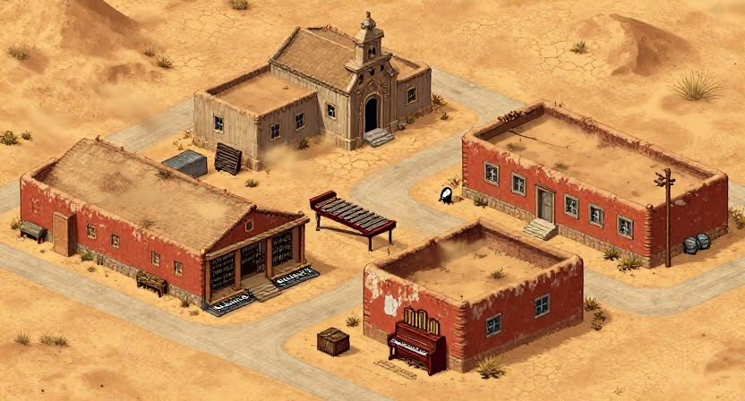
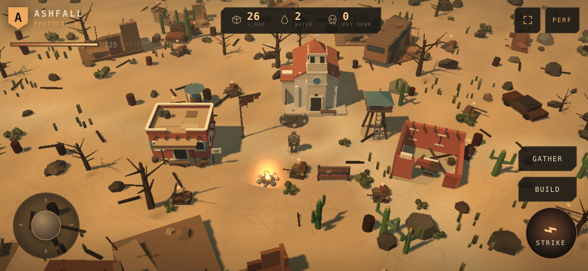
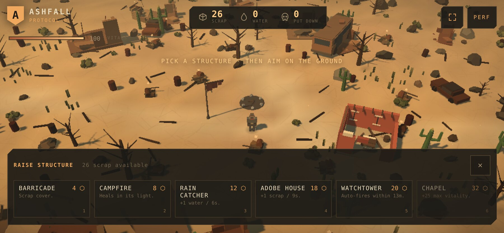
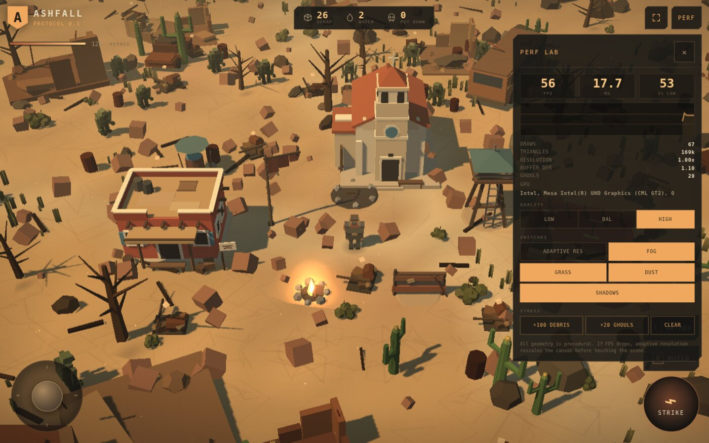
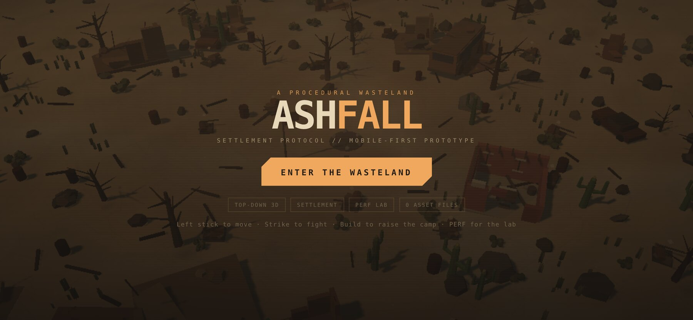

# ASHFALL — wasteland settlement protocol

A quick, mobile-first **top-down 3D RPG / settlement-building prototype** built with Three.js.
Scavenge a procedural dust plain, raise an adobe camp, and keep the ghouls outside the firelight.
Every mesh, texture and gust of ash is generated at runtime. The only assets are six short
recorded gunshot close-layers (168 KB); everything else in the audio engine is synthesised.

This pass also targets the supplied isometric desert-town reference: **sun-bleached sand, cracked
earth, red adobe walls, cream stucco, a bell tower, flat roofs, blue shutters, cacti and crisp
directional shadows**, rendered as low-poly procedural geometry.

The goal of the prototype is not content volume. It is to find out **how much 3D atmosphere and
simulation a mobile browser can carry comfortably**, and to provide an in-game lab for finding the
ceiling.

| Provided direction | Procedural interpretation |
| --- | --- |
|  |  |

---

## Quick start

**Play online: https://symptom-pg740.github.io/ashfall/**

The site is deployed automatically from `main` by GitHub Actions (`.github/workflows/deploy.yml`).

```bash
npm install
npm run dev
```

Open **http://localhost:5173**. On a phone on the same network, open the LAN address Vite prints
(the dev script already listens on `0.0.0.0`).

Production check:

```bash
npm run build
npm run preview
```

Requirements: Node 20+ and a WebGL2 browser. Tested in Chrome; Safari is the next real-device target.

---

## Controls

| Action | Touch | Desktop |
| --- | --- | --- |
| Select a survivor | tap the unit or its roster button | click the unit |
| Order | with a unit selected, tap enemy / scrap / ground | click the target |
| Take / release control | `TAKE CONTROL` / `RELEASE` | same buttons |
| Move (direct mode) | Left stick | `WASD` / arrows |
| Strike / fire | `STRIKE` / `FIRE` button | `Space` |
| Gather scrap | `GATHER` button (appears near a pile) | `E` |
| Open build tray | `BUILD` | `B` |
| Pick structure | Tap a card / swipe the tray | `1`–`6` |
| Aim placement | Tap / drag the ground | Move mouse, click ground |
| Confirm / cancel | `PLACE` / `CANCEL` | `Enter` / `Esc` |
| Wardrobe | `OUTFIT` | `O` |
| Perf lab | `PERF` | `P` |
| Fullscreen | ⛶ button, top right | `F` |
| Orient / lock rotation | phone button, top right | — |
| Pan the camera | drag the ground | drag the ground |
| Zoom | pinch | mouse wheel |
| Rotate the camera | drag the compass | compass, `,` / `.` |
| Face north / recenter | tap compass / tap its centre | `R` / `H` |
| Close menus | `✕` | `Esc` |

The camera is a **fixed-pitch orthographic rig** — no free pitch or zoom. One finger drags the ground
to **pan**; the compass ring is the only touch control that **rotates** the camera (drag it, or tap
to face north). Tapping the compass centre re-centres the camera on the player. Movement stays
screen-relative, so `W` is always "up", and during placement the same ground drag aims the ghost
instead of panning.

**Command mode is the default.** The stick is hidden until you select a survivor and press **TAKE
CONTROL**. A unit ordered to a scrap pile walks there, harvests, carries the load back to you and
deposits it; ordered at a ghoul it closes to weapon range and fights. The roster strip is the
reliable way to select a unit when the camp is crowded.

---

## The 60-second loop

1. Start with **26 scrap**. Scrap piles are marked by floating amber shards; each gives **6–12 scrap**.
   In command mode, select a survivor and tap a pile: they gather it and haul it back to you.
2. Build a **Campfire** (8) to heal inside its light, or a **Barricade** (4) for solid cover.
3. A **Rain Catcher** (12) adds **+1 water / 6 s**. An **Adobe House** (18) sends out scavengers for
   **+1 scrap / 9 s**.
4. A **Watchtower** (20) auto-fires at ghouls within 13 m. A **Chapel** (32) grants **+25 max vitality**
   and heals nearby.
5. Ghouls arrive after a grace period, drop **2 scrap**, and get denser over time. Death costs 20% of
   your scrap and respawns you at the old camp. Buildings persist.

Placement is ghost-previewed, grid-snapped, slope-checked, and blocked by structures and wreckage.
Structures are solid to both the player and ghouls.

---

## Try the performance lab first

The in-game **PERF** panel is the point of this prototype.

- **LOW / BAL / HIGH** — changes DPR cap, base render scale, grass count, ember count, natural ghoul
  cap and shadow-map size. **LOW disables shadows entirely.**
- **ADAPTIVE RES** — resolution is rescaled in 0.09 steps between 0.5× and 1.0× of the DPR cap. It
  reacts to average frame time every ~500 ms, with a cooldown so it does not oscillate.
- **FOG / GRASS / DUST** — instant scene-cost toggles (fog is density-only, so there is no shader recompile).
- **SHADOWS** — toggles the single directional shadow pass at runtime (one shader recompile).
- **Automatic last resort** — if adaptive resolution reaches its floor and the game still cannot hold
  ~40 fps for 3 seconds, the shadow pass is disabled once to keep the game playable.
- **+100 DEBRIS** — 100 extra instances in **one draw call**.
- **+20 GHOULS** — adds to the fixed 64-instance ghoul pool.
- **CLEAR** — hides the stress horde and debris.
- **WORLD** — shows the current seed (`?seed=` in the URL). **REROLL SEED** reloads with a new one;
  terrain, props, scrap and ghouls all derive from it, so the whole world changes.

Read **FPS, ms, 1% low, draw calls, triangles, resolution scale, buffer DPR, ghouls and GPU**.
The graph keeps the last ~45 seconds.

| Build tray | Performance lab |
| --- | --- |
|  |  |

---

## What is implemented

- **Procedural terrain** — a seeded, baked 384² height/slope/moisture/road field (fBm, domain warp,
  ridged rim, soft terraces, droplet erosion) drives the mesh, props, player, buildings and enemies.
  Vertex-coloured with a generated tiling sand albedo + normal map, winding dirt road, cross street
  and ash/rust patches.
- **Art direction** — sun-bleached sand, warm key light, cool fill, **real-time crisp shadows**,
  red adobe, cream stucco, terracotta roofs, blue shutters, exposed beams, cacti, shrubs and mesas.
- **Procedural props** — rocks, dead trees, saguaro cacti, desert shrubs, broken ruins, wrecked cars,
  a bus landmark, an **abandoned adobe ruin with a piano**, a camp banner, scrap piles, planks,
  barrels, rubble, clustered dry grass and distant mesas. Placed with blue-noise scatter masked by
  slope, moisture and roads; grass and shrubs sway in a vertex shader. Rocks use a cracked-rock
  albedo + normal set; houses use plaster detail and baked base AO.
- **Continue a run** — seed + player state + equipment + buildings + scrap + ammo/magazines + weapon
  upgrades + production timers are auto-saved to localStorage (schema `v: 2`; `v: 1` runs migrate in
  place and start with the default ammo pouch). Reload shows **CONTINUE**; **NEW RUN** clears the
  save, and PERF has **RESET SAVE**.
- **Command layer (Phase 1)** — the camp survivors are selectable units with a roster, a selection
  ring and contextual orders: tap an enemy to engage, a scrap pile to gather/haul, or the ground to
  move. `TAKE CONTROL` possesses any survivor (joystick, camera follow, that unit's weapon and HP);
  `RELEASE` returns to command mode. This is the first slice: the warehouse, power chain and tower
  assignment are the next phases.
- **Procedural humanoids** — a parametric generator with lean/stocky/tall archetypes and proportion
  jitter. The player is a skinned R4 character: the MakeHuman `hm08` head (CC0) with a procedural
  hair shell, eyes and brows, on a slim 20-bone skinned body with automatic weights, two-bone foot
  IK, PBR-lite, IBL and a character atlas with skin/cloth/leather/metal regions. The three camp folk
  use the same skinned builder at a lower detail level, with a **static merged far LOD** above 24 m;
  `?chars=blocky` and `?chars=smooth` keep the older rigs for comparison.
- **Wardrobe** — 10 equipment slots (head, face, torso, legs, feet, shoulders, hands, back, waist,
  weapon) with multiple items each. Torso/legs/feet rebuild a skinned outfit layer that shares the
  body skeleton; the rest are meshes on bone sockets. Changes are live, saved with the run, and the
  far LOD is re-baked for NPCs. Open it with **OUTFIT** / `O` and tap a slot to cycle.
- **Firearms** — the player starts with a **scrap pistol**, the fast/light sidearm (12-round
  magazine, 360 rpm, 1.3 s reload). The wardrobe also carries the **pipe rifle**, a slow single-shot
  weapon: 60 damage (one-shots a ghoul), 0.3° spread, 35 m, one round with a 1.1 s reload after each
  shot. Shots are hitscan rays tested against analytic ghoul capsules; a shared target registry
  auto-aims the character, while firing stays on the player's input. The shot is presented with a
  travelling tracer, muzzle flash and smoke, surface-specific impacts and ground decals, a brass
  casing with a bounce, a hybrid gunshot (six short recorded close layers over synthesised sub,
  action and a generated convolution tail), a floating damage number and a brief hit-stop on kills.
  Impacts, reloads, dry fire, casings, footsteps and a low wind bed are synthesised; **SOUND** in the
  PERF panel mutes everything and the choice persists. The six gunshot recordings are the only
  audio assets — see [public/audio/CREDITS.md](public/audio/CREDITS.md). The rifle
  is **two-handed**: its left hand is solved onto the foregrip with a two-bone arm IK, while the
  right hand holds the grip. One camp folk is armed with a pistol and **auto-engages ghouls** using
  the same aim controller. After about a minute a small **raider squad** attacks the camp: hostile
  skinned riflemen use the same auto-aim/fire path, can hit the player and the camp guard, and the
  guard can go down and respawn. The **RAID** banner tracks the remaining hostiles; clearing the
  squad awards +10 scrap. Raiders that lose line of sight move to a firing position around the
  player instead of standing behind cover, and a raider that survives a hit flinches to a new firing
  position and holds fire briefly (**suppression**). The wardrobe also carries a **sawn-off shotgun**
  (6×9 pellets, 2 shells, close range, two-handed). Clearing a raid shows a **RAID CLEARED** card
  (+10 scrap); dying during one shows **RAID LOST**. Melee remains available by equipping the
  blade/club. There are no automatic player weapons yet.
- **Ammo and upgrades** — a finite reserve per caliber (rifle rounds, pistol rounds, shells) is
  carried in the save; every gun keeps the magazine you left in it, and reloading draws from the
  reserve. The **ARMORY** section of the outfit panel spends scrap on ammo packs and on four
  per-weapon tracks (**damage, rate, reload, spread**, 2–3 tiers each). Tracks are data-driven
  multipliers over the base weapon spec, so variants and new weapons are config, not code.
  `?armory=1` opens the panel for testing.
- **Pinch or the mouse wheel zooms 0.8–2.2×.**

- **Six settlement structures** — Barricade, Campfire, Rain Catcher, Adobe House, Watchtower and Chapel.
  Generated geometry, ghost placement, costs, production, healing and auto-fire. The Adobe House is
  assembled from a modular kit (facade bays, roof, parapet, porch, rooftop clutter) and gets a seeded
  variant per placement; the other five stay hand-authored parametric shells.
- **Combat** — an instanced ghoul pool, chase/attack/knockback, separation, solid buildings and
  wreckage, strike arc, loot, death and respawn.
- **Atmosphere** — warm dusk sky, dust motes, campfire glow pools, contact shadows, fog, vignette.
- **Mobile shell** — safe-area-aware HUD, large touch targets, virtual stick, horizontally scrollable
  6-card build tray, keyboard hints hidden on touch, no page zoom/scroll/bounce, **fullscreen button**,
  HUD that fades in after the start screen.

| Start screen |
| --- |
|  |

---

## Architecture

```
index.html            UI shell + start screen + fullscreen button
src/main.js           bootstrap, state, game loop, wiring
src/terrain.js        shared height field, terrain mesh, cracked-earth texture
src/sky.js            sky dome shader, lights, fog, shadow configuration
src/props.js          instanced scenery, landmarks, contact shadows, mesas
src/resources.js      scrap nodes, markers, respawn
src/player.js         procedural survivor + animation
src/enemies.js        instanced ghoul pool + AI
src/settlement.js     six structures, merged geometry, ghost, placement, production
src/particles.js      dust/embers and pooled bursts
src/perf.js           FPS sampling, quality presets, adaptive resolution
src/input.js          virtual stick, keyboard, ground raycast
src/ui.js             HUD, build tray, perf lab, fullscreen
src/geo.js            primitive/merge/colour helpers, procedural canvas textures
src/rng.js            seeded RNG, easing helpers
```

Everything is in one frame. There is no post-processing, no physics engine and no external art
pipeline. The shadow pass is the only additional render pass.

---

## Measured on the prototype

These numbers were taken in **Chrome with mobile device emulation on a desktop Intel UHD GPU**.
They are useful for relative comparisons, **not proof of phone performance**. Each row is a separate
run; the scene contents differ.

| Scenario | Draw calls | Triangles | Buffer DPR | FPS | 1% low |
| --- | ---: | ---: | ---: | ---: | ---: |
| Emulated mobile 844×390, balanced, default scene | 49 | 158k | 1.28 | ~60 | — |
| Camp (6 structures), balanced, shadows on | 66 | 164k | 1.28 | ~60 | 52 |
| Camp + 300 debris + 21 ghouls, shadows on | 70 | 168k | 1.60 | 57 | 54 |
| Same scene, shadows off | 43 | 96k | 1.60 | 57 | 53 |
| Desktop high, camp + 300 debris + 20 ghouls | 67 | 169k | 1.10 | 56 | 53 |

Observations:

- **The whole ghoul pool is one draw call.** The stress debris is one more.
- **The shadow pass adds roughly +27 draw calls and +72k triangles** in the stress scene. On the
  desktop test GPU it did not move the frame rate; on real phones it is the first thing to measure.
- Shadows, not raw scene geometry, are the biggest new cost. That is why **LOW** disables them and
  the lab exposes a toggle.
- The scene sits around **~50–70 draw calls and ~160k triangles including the shadow pass**. That is
  still a reasonable mobile budget, but it is no longer "free"; fill rate and thermals matter.
- The adaptive loop raised the buffer to its 1.6 DPR cap in the stress run when there was headroom;
  on a real phone it will move the other way. The **1% low** is the number to watch.
- This is a **single main pass plus one 1024/2048 shadow map**, with no post FX.

### Where it can break next

- High-DPR phones at `HIGH` (2.0 DPR cap) are fill-rate bound long before geometry is an issue.
- Shadow-map cost on older mobile GPUs; `LOW` exists for that reason.
- Thermals over 10+ minute sessions: adaptive resolution cannot fix a device that is throttling its GPU.
- More *unique* buildings or props add draw calls unless merged/instanced.
- Dozens of campfires add transparent overdraw from glow sprites/planes.
- Scaling the ghoul pool to hundreds makes the O(n²) separation noticeable.
- Real Safari/WebGL differences need to be measured, not extrapolated from Chrome.

---

## Design choices for mobile comfort

1. **A fixed-pitch orthographic camera** with compass-driven yaw, drag-to-pan, a recenter control,
   damped follow and a separately tuned portrait framing (landscape is the primary view).
2. **One low-resolution shadow map focused on the camp**, not a cascaded shadow stack. Casters are
   limited to meaningful scenery; grass only receives.
3. **Instancing and merging everywhere.** Terrain is one mesh; scenery groups, grass, contact shadows,
   scrap and ghouls are instanced; each building is one merged geometry.
4. **DPR cap + dynamic resolution scale**, defaulting to `balanced` on touch devices.
5. **Cheap materials** (`MeshLambertMaterial`, vertex colours) and **procedural canvas textures**
   only for the cracked ground, glow and contact shadows.
6. **No per-frame allocations** in the hot paths; UI DOM writes are diffed.
7. **dt clamped at 50 ms** and `requestAnimationFrame` paused on hidden tabs.
8. **Touch-first layout**: 118 px stick, 92 px strike button, large build cards, safe-area insets,
   no zoom/scroll, horizontally scrollable build tray, fullscreen support.
9. **Start-screen HUD fade** so the first view is the world, not a wall of controls.
10. **Adaptive floor fallback**: at minimum resolution, a persistently sub-40 fps session disables
    the shadow pass once rather than silently dropping frames forever.

---

## Fullscreen

The ⛶ button sits beside **PERF** and toggles the Fullscreen API (also `F` on desktop). The icon
switches between expand/compress and the game reframes after the viewport changes.

On **iPhone Safari**, element fullscreen is not available. The button reports that clearly and
suggests Add to Home Screen instead. iPad, Android Chrome and desktop browsers support the API.

---

## Direction: from prototype to game

Ashfall is moving from a single-character prototype to a **settlement command game**. The camp
survivors become a roster of units you order around; you can still take direct control of any one of
them. Resources are hauled to a warehouse, and defences run on a solar → pole → wire → turret power
chain. The turret only engages non-humans; human raids are your units' problem.

- **[docs/GAME_PLAN.md](docs/GAME_PLAN.md)** — the full plan: control model, contextual orders,
  warehouse/economy, day/night, electricity, Vickers turret, watchtower assignment, progression and
  the relay objective. It includes the phased build order and acceptance gates.
- **[docs/REALISM.md](docs/REALISM.md)** — the backlog of realism work we are deliberately
  deferring (audio tails/occlusion, animation, wounds, needs, weather, destruction), with cost and
  priority, so it is not lost.

**Immediate next slice (Phase 1):** unify the leader and NPCs into `Unit`, add the roster and
tap-vs-drag selection, contextual move/attack/gather orders, and `TAKE CONTROL` / `RELEASE` with the
joystick hidden in command mode. The first milestone is: select a survivor, send them to a scrap
pile, watch them walk, gather and return, then take control and walk back yourself.

The old prototype priorities still apply inside that plan: real-device testing, adaptive-resolution
fallbacks, PWA install, and a 30 fps battery mode are Phase 7 gates, not forgotten work.

---

## Known limitations

- Not yet profiled on a physical phone.
- Command mode is a first slice: the warehouse, power chain and tower assignment are not built yet.
  Movement is direct steering with collision push, not a navmesh.
- The watchtower still auto-fires until Phase 4 gives it an assigned gunner.
- iPhone Safari does not support element fullscreen; use Add to Home Screen.
- Shadow cost on older mobile GPUs is the main open performance question.
- Circle collisions; no navmesh/pathfinding. Ghouls and raiders can catch on large wreckage.
- Water is produced but has no sink/economy yet.
- No building removal or rotation; weapon upgrades exist but there is no settlement tech tree.
- Ghouls, hostile rifle raiders and the camp guard only; pistol, pipe rifle and sawn-off.
- Procedural low-poly art, not production art. Six recorded gunshot layers are the only assets.
- `window.__ashfall` is deliberately exposed for tuning. It is not part of the game UI.

### Test hooks

Append to the URL:

| Hook | Effect |
| --- | --- |
| `?fresh=1` | ignore and clear the saved run (deterministic testing) |
| `?autostart=1` | skip the title screen |
| `?zoom=2.4` | camera zoom |
| `?weapon=rifle` | equip a weapon (`pistol`, `rifle`, `shotgun`, or melee) |
| `?ghoul=1` | one stationary ghoul in front of the player |
| `?raider=1` | one hostile raider beside the player |
| `?raid=1` | start a raid immediately |
| `?raidclear=1` | spawn and immediately clear a raid |
| `?armory=1` | open the outfit/armory panel |
| `?upgrade=damage` | buy one upgrade tier and open the panel |
| `?noammo=1` | empty the pouch and magazine |
| `?hurt=60` | apply damage after a second |
| `?fastforward=5&ffdelay=2000` | step the simulation deterministically |
| `?audiotest=1` | play the whole sound set in sequence |

### Tuning from the console

```js
__ashfall.state.scrap = 500;
__ashfall.enemies.spawn(20, __ashfall.player.x, __ashfall.player.z, 18);
__ashfall.actions.doStress('debris');
__ashfall.actions.doStress('ghouls');
__ashfall.actions.applyQuality('low');
__ashfall.audio.shot('rifle');
__ashfall.audio.setMuted(true);
```

---

## Why this is a useful ceiling test

The prototype now shows a clear art direction at a mobile-friendly scene budget:

- The desert settlement look — adobe, stucco, shadow, cacti, cracked ground — is achievable with
  ~50–70 draw calls and ~160k triangles including a real shadow pass.
- Shadows add the most visual value per unit of engineering, and the most cost. The next phone test
  should answer whether 1024 px / 30 m is the right point on that curve.
- If new content stays instanced/merged and the lighting model stays this simple, there is room for a
  larger town, more enemies and more props before geometry becomes the bottleneck.
- The adaptive resolution loop is the safety net that makes "smooth on mobile" survivable across
  device tiers — but it needs real-device thermal testing to be trusted.

Next step: run it on physical phones, leave the perf lab open, and use the observed 1% lows to pick
the device tiers and the content budget.
